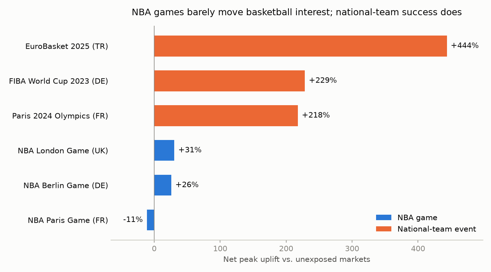

# NBA Europe: how much extra basketball demand to plan for

Razvan Mihaila · October 2026

**The question.** How much extra basketball demand should Nike EMEA plan for around the NBA Europe launch (2027–28), and how confident should it be? This memo uses Wikipedia interest around comparable past events as a proxy for attention.

**Recommendation.**

- Plan for +6.5% to +13% above baseline basketball category demand for the 2027–28 launch season, the same in all six host markets (UK, France, Spain, Italy, Germany, Turkey).
- Buy to the base case, not the high case; this holds whether excess stock is cleared at 30% or 50% off.
- Keep player-specific product (signature shoes, jerseys) flexible: small initial buys, fast replenishment.

**Why.**

- NBA games in Europe lifted basketball interest by −11% to +31% (net of unaffected markets) and faded within 1–3 weeks.
- National-team success lifted it by +218% to +444%.
- Around the NBA games, attention went mostly to the home players' own pages, not to basketball in general.

**Scenarios and buy.** k is the share of extra interest assumed to become extra purchases; no public data links the two, so two values are tested.

| Scenario | Probability | Demand uplift (k=0.25) | Demand uplift (k=0.5) |
|---|---|---|---|
| Low | 40% | 0.0% | 0.0% |
| **Base (recommended buy)** | 40% | **+6.5%** | **+13.1%** |
| High | 20% | +7.7% | +15.3% |
| Expected | — | +4.1% | +8.3% |

**Biggest assumption.** k. If it is closer to 0.25, plan at the bottom of the range; if closer to 0.5, at the top. The buy level (base case) holds either way.

**What I'd do with Nike's data.** Measure k from past sell-through around interest spikes; split signature vs. general basketball product.

**Limitations.**

- Wikipedia measures attention, not purchases, and a language edition is not a country.
- Only three NBA games and no European league has existed before.
- Greece (also a target market) is not covered, and the one-off NBA games planned for 2027–28 will add their own short bumps.

Method, full results and code: [github.com/razvan-m-30/nba-europe-demand-plan](https://github.com/razvan-m-30/nba-europe-demand-plan); see docs/methodology.md.

**Sources:**

- [FIBA, Men's Olympic Basketball Tournament Paris 2024](https://www.fiba.basketball/en/news/everything-you-need-to-know-mens-olympic-basketball-tournament-paris-2024)
- [NBA.com, Paris 2024 Olympic basketball schedule](https://www.nba.com/news/faq-paris-olympics-basketball-2024)
- [NBA, Paris Games 2025](https://nbaevents.nba.com/paris-games-2025)
- [NBA.com, Berlin Game 2026 primer](https://www.nba.com/news/nba-berlin-game-primer-2026)
- [NBA.com, London Game 2026 preview](https://www.nba.com/news/nba-london-game-2026-everything-to-know)
- [Wikipedia, 2023 FIBA Basketball World Cup](https://en.wikipedia.org/wiki/2023_FIBA_Basketball_World_Cup)
- [Wikipedia, EuroBasket 2025](https://en.wikipedia.org/wiki/EuroBasket_2025)
- [NBA.com, games in Europe 2026–2028 announcement](https://www.nba.com/news/nba-announces-3-year-slate-of-games-in-europe-beginning-in-2026)
- [SEC EDGAR, Nike 10-K FY2025 (gross margin)](https://www.sec.gov/Archives/edgar/data/320187/000032018725000047/nke-20250531.htm)
